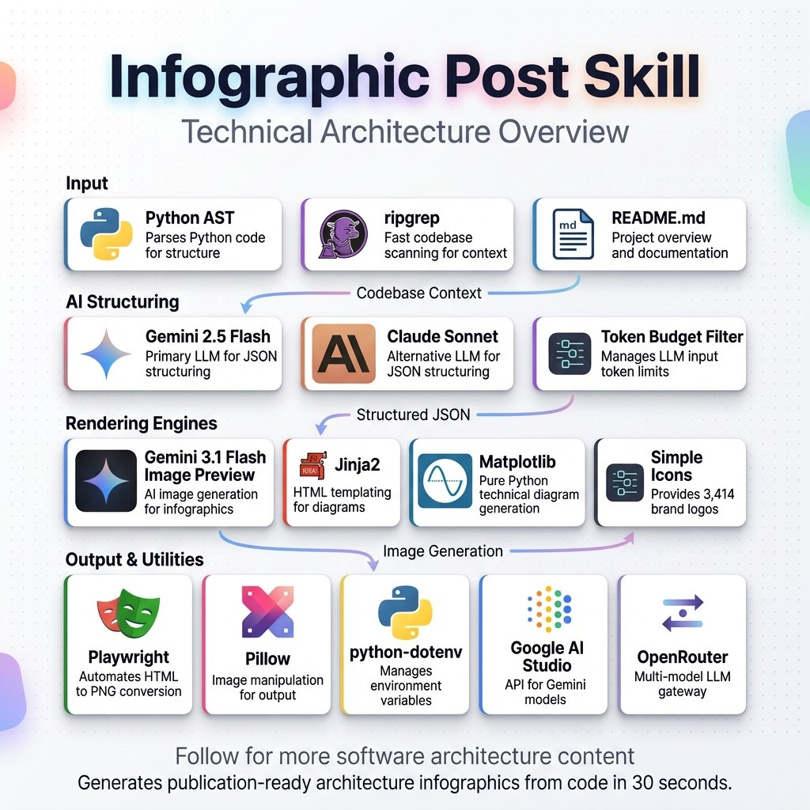
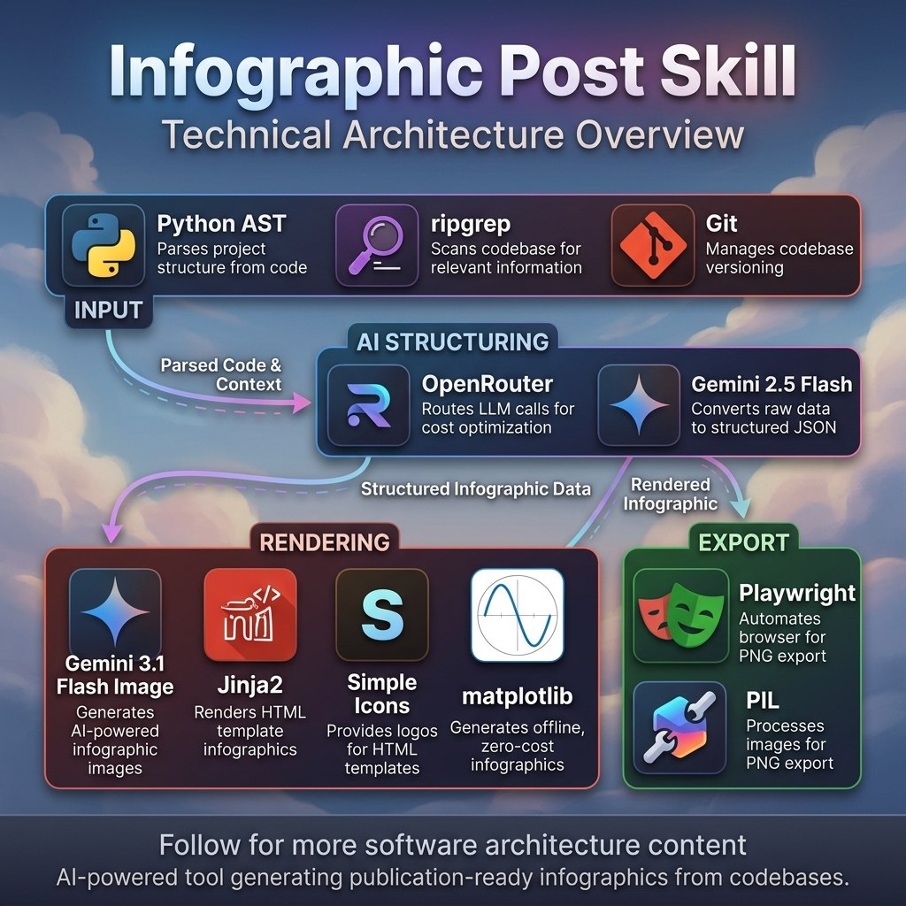

# Infographic Skill for Claude Code

Generate professional, publication-ready infographics from your codebase, data, or concepts — directly from Claude Code or the CLI.

## What It Does

Three rendering modes with different quality/cost tradeoffs:

| Mode | Quality | Cost | API Required | Best For |
|------|---------|------|-------------|----------|
| 🎨 **AI Image** (default) | ★★★★★ Designer-quality | ~$0.04/image | Google AI Studio | LinkedIn posts, presentations |
| 🖥️ **HTML Template** | ★★★★☆ Professional | Free (offline) | None | Quick drafts, no API key |
| 📊 **Matplotlib** | ★★★☆☆ Clean & functional | Free (offline) | None | Documentation, print |

### Example output (AI Image mode)

```
"Make an infographic of this project's architecture"
→ Reads your codebase automatically
→ AI structures it into layers (Frontend, Backend, AI/ML, Database, Auth, Infra)
→ Gemini generates a 1080×1080px publication-ready PNG with brand logos,
  data flow arrows, illustrated background, and professional typography
```

The skill run on its own repository, in the `modern-light` and `illustrated` styles:




## Install

As a Claude Code plugin:

```
/plugin marketplace add arnaugonzalez/infographic-post-skill
/plugin install infographic-post-skill@infographic-post-skill
```

For any agent that reads skills (Claude Code, Codex, Cursor, Gemini CLI):

```bash
npx skills add arnaugonzalez/infographic-post-skill
```

The skill asks before installing its Python dependencies
([`skills/infographic/requirements.txt`](skills/infographic/requirements.txt)), needs Python 3.9+,
and reads API keys from your environment.

## What it runs and sends

- **Runs** the Python scripts in `skills/infographic/scripts/` on your machine. They read the
  project you point them at and write the image (or HTML) where you ask.
- **Sends**, in the AI modes only, a summary of your code with API keys redacted to the LLM you
  configure on [OpenRouter](https://openrouter.ai) (`INFG_OPENROUTER_API_KEY`), and the image
  prompt to Google's Gemini API (`INFG_API_KEY`). Both use your own keys and bill your accounts.
- **Sends nothing** in Matplotlib mode, which works fully offline.
- Stores nothing besides the files it generates.

## Quick Start (CLI)

### Prerequisites

- Python 3.9+
- pip

### 1. Install

```bash
git clone https://github.com/arnaugonzalez/infographic-post-skill.git
cd infographic-post-skill/skills/infographic
pip install -r requirements.txt
```

### 2. Set up your API keys

```bash
cp .env.example .env
# Edit .env and add your keys (see Setup section below), or export them in your shell
```

### 3. Generate your first infographic

```bash
# From skills/infographic/:
python scripts/generate_pretty.py --codebase /path/to/your/project --output my_infographic.png
```

## Rendering Modes Explained

### 🎨 Mode 1: AI Image Generation (Recommended)

**How it works:** Reads your codebase → LLM structures it into JSON → Builds a detailed "designer brief" prompt → Gemini image model generates a publication-quality PNG directly.

**Why it's best:** The image model creates illustrated backgrounds, large recognizable brand logos, flowing data arrows, and professional composition — like hiring a designer on Fiverr, but in 30 seconds for $0.04.

**Required:** Google AI Studio API key (`INFG_API_KEY`)

```bash
# Default — uses gemini-3.1-flash-image-preview
python scripts/generate_pretty.py --codebase . --output arch.png

# Choose infographic type
python scripts/generate_pretty.py --codebase . --infographic-type comparison --output compare.png

# Choose visual style
python scripts/generate_pretty.py --codebase . --style illustrated --output arch.png
```

**Available image models:**

| Model | Quality | Cost/image | Speed | Notes |
|-------|---------|-----------|-------|-------|
| `gemini-3.1-flash-image-preview` | ★★★★★ | ~$0.04 | ~15s | Default. Best quality. Native PNG generation. |
| `gemini-2.5-flash-image` | ★★★★☆ | ~$0.04 | ~12s | Stable fallback. Slightly less detail. |

### 🖥️ Mode 2: HTML Template (No API key for rendering)

**How it works:** Reads codebase → LLM structures it into JSON → Jinja2 template renders a glassmorphism HTML infographic → Playwright screenshots to PNG.

**Why use it:** Free rendering (only the LLM structuring call costs ~$0.001). Real SVG brand icons from Simple Icons (3,414 brands). Deterministic layout — same template always looks the same.

**Required:** OpenRouter API key (`INFG_OPENROUTER_API_KEY`) for the structuring LLM call. Optionally Playwright for PNG export.

```bash
# Force HTML template mode (skips AI image even if Gemini key is available)
python scripts/generate_pretty.py --codebase . --legacy-html --output arch.html

# Or when INFG_API_KEY is not set, it falls back to HTML template automatically
```

### 📊 Mode 3: Matplotlib (Fully Offline)

**How it works:** Parses project structure → Generates a clean architecture diagram using matplotlib with hand-drawn category icons and connection arrows.

**Why use it:** Zero API keys, zero cost, zero network. Works on air-gapped machines.

```bash
# Parse project context
python scripts/parse_context.py --root . --output arch.json

# Generate matplotlib diagram
python scripts/generate_linkedin_arch.py --config arch.json --output arch.png
```

## Infographic Types

### Architecture (default)

Shows your system's components grouped by layer with data flow connections.

```bash
python scripts/generate_pretty.py --codebase . --infographic-type architecture
```

**What to ask Claude:** "Make an architecture infographic of this project" / "Generate a LinkedIn architecture diagram"

### Comparison

Side-by-side before/after or v1 vs v2. Shows transformation with red→green indicators.

```bash
python scripts/generate_pretty.py --codebase . --infographic-type comparison
```

**What to ask Claude:** "Compare our old architecture vs new" / "Make a before/after infographic of the migration"

### Feature Explanation

Step-by-step visual showing how a specific feature works internally.

```bash
python scripts/generate_pretty.py --codebase . --infographic-type feature
```

**What to ask Claude:** "Explain how our auth flow works as an infographic" / "Make a visual showing how the AI pipeline processes entries"

### Process Flow

Sequential pipeline or workflow visualization.

```bash
python scripts/generate_pretty.py --codebase . --infographic-type process
```

**What to ask Claude:** "Show the deployment pipeline as an infographic" / "Visualize the CI/CD workflow"

### Cheat Sheet

Dense reference card with sections — designed to be saved/bookmarked.

```bash
python scripts/generate_pretty.py --codebase . --infographic-type cheatsheet
```

**What to ask Claude:** "Create a cheat sheet of our API endpoints" / "Make a reference card for the configuration options"

## Art Direction

Most AI infographics look the same: navy background, purple glow, a grid of rounded cards, emoji.
This skill makes the model commit to one archetype and a one-sentence thesis before it draws,
keeps it to about twelve elements, bans the usual patterns, and shows it reference pages from a
folder of real graphics so it copies their restraint instead of the average.

| Archetype | Look |
|-----------|------|
| `editorial` (default) | Paper and ink, display serif, numbered rows, one accent color |
| `blueprint` | Engineering drawing: grid, monospace labels, outlined boxes |
| `terminal` | One monospace family; a command, its output and the line that matters |
| `swiss` | Poster: neo-grotesque, strict grid, one huge number |
| `brutalist` | Zine: thick borders, heavy type, one loud color block |

```bash
python scripts/generate_pretty.py --codebase . --style editorial --format portrait
# Use your own graphics as the reference instead of the bundled ones
python scripts/generate_pretty.py --codebase . --style-dir ~/my-posts
```

Formats: `portrait` 1080×1350 (default), `square` 1080×1080, `landscape` 1280×640. When the HTML is
finished, `--finish` warns about every banned pattern it still finds (gradients, glow, card grids,
emoji, purple, generic fonts). The pre-0.2 names `modern-light`, `modern-dark` and `illustrated`
map to `editorial`, `blueprint` and `swiss`.

## Choosing a backend and model

Run `python scripts/doctor.py` (from `skills/infographic/`) to inspect installed subscription CLIs and environment variables without exposing key values:

| Backend | Default model | Billing |
|---------|---------------|---------|
| `session` | Host agent (`CLAUDECODE`) | Subscription |
| `claude` | `claude-opus-5-5` | Subscription |
| `agy` | `claude-opus-5-5-low` | Subscription |
| `codex` | CLI default | Subscription |
| `copilot` | `auto` | Subscription |
| `opencode` | CLI default | Subscription |
| `api` | `claude-haiku-5-5` / `gemini-3.8-flash` | Paid API (per use) |

Pass `--backend <name> --model <id>` (or set `INFG_BACKEND` / `INFG_MODEL`) to `scripts/generate_pretty.py` or `scripts/claude_html_renderer.py`. Use `--print-prompt` on `scripts/claude_html_renderer.py` to inspect the assembled prompt and model-family instructions. **Rule: `auto` never picks a paid API** — it chooses `session` inside Claude Code or the first installed subscription CLI, and requires `--backend api` (or `--renderer image`) before spending API credits.

## Setup

### Option A: Google AI Studio (recommended — enables AI Image mode)

1. Get a free API key at https://aistudio.google.com/apikey
2. `cp skills/infographic/.env.example skills/infographic/.env` (or export the variable in your shell)
3. Set `INFG_API_KEY=your-key-here`

This enables the ★★★★★ AI image generation mode (~$0.04/image).

### Option B: OpenRouter (enables HTML Template mode)

1. Get an API key at https://openrouter.ai/keys
2. `cp skills/infographic/.env.example skills/infographic/.env` (or export the variables in your shell)
3. Set:
   ```
   INFG_OPENROUTER_API_KEY=sk-or-v1-your-key
   INFG_LLM_MODEL=google/gemini-2.5-flash
   ```

This enables the ★★★★☆ HTML template mode (~$0.001/infographic).

### Option C: Both (recommended for best experience)

Set both `INFG_API_KEY` and `INFG_OPENROUTER_API_KEY`. The tool will:
- Use OpenRouter for codebase structuring (cheap, fast)
- Use Gemini image model for the final visual (high quality)

### LLM model selection for codebase structuring

The LLM that reads your codebase and structures it into layers has three quality tiers:

| Tier | Models | Cost | Quality |
|------|--------|------|---------|
| **Tier 1** (best) | `anthropic/claude-sonnet-4.6`, `google/gemini-2.5-pro`, `openai/gpt-5.2`, `deepseek/deepseek-v3.2` | $0.01-0.10 | Most accurate layer grouping, best descriptions |
| **Tier 2** (good) | `google/gemini-3-flash-preview`, `google/gemini-2.5-flash`, `stepfun/step-3.5-flash` | $0.001-0.01 | Good accuracy, occasional misses |
| **Tier 3** (budget) | `meta-llama/llama-3.3-70b-instruct`, `microsoft/phi-4`, legacy models (gpt-4o, claude-sonnet-4) | <$0.001 | Fewer items detected, generic descriptions |

Set in `.env`:
```
INFG_LLM_MODEL=google/gemini-2.5-flash   # Tier 2 — best value (default)
```

**Note:** The LLM tier affects the *content accuracy* (what technologies are detected, how they're described). The *visual quality* is determined by the rendering mode (AI Image vs HTML Template vs Matplotlib), not the LLM.

## Cost Summary

| What you're doing | AI Image mode | HTML Template mode | Matplotlib |
|---|---|---|---|
| **Rendering cost** | ~$0.04 (Gemini image) | Free (Playwright) | Free |
| **LLM structuring cost** | ~$0.001-0.01 (OpenRouter) | ~$0.001-0.01 (OpenRouter) | Free |
| **Total per infographic** | **~$0.04-0.05** | **~$0.001-0.01** | **Free** |
| **API keys needed** | INFG_API_KEY + INFG_OPENROUTER_API_KEY | INFG_OPENROUTER_API_KEY only | None |

## CLI Reference

```bash
python scripts/generate_pretty.py \
  --codebase <dir>              # Read and analyze a codebase directory
  --title "My App"              # Override the title (default: derived from directory name)
  --infographic-type <type>     # architecture|comparison|feature|process|cheatsheet
  --style <archetype>           # editorial|blueprint|terminal|swiss|brutalist
  --format <canvas>             # portrait|square|landscape (HTML renderer)
  --style-dir <dir>             # your own .html graphics as reference
  --model <gemini-model>        # Image model (default: gemini-3.1-flash-image-preview)
  --llm-model <model>           # LLM for structuring (default: from INFG_LLM_MODEL env)
  --output <path>               # Output file path
  --legacy-html                 # Force legacy LLM-generated HTML (v1 behavior)
  --template <name>             # Jinja2 template for HTML mode (default: arch-dark-glassmorphism)
```

## Using as a Claude Code Skill

Once installed, just ask Claude naturally:

> "Make an infographic of this project's architecture"
> "Generate a LinkedIn diagram for this codebase"  
> "Create an architecture infographic for linkedin"
> "Make a comparison infographic: before vs after the migration"
> "Explain how the auth flow works as an infographic"
> "Create a cheat sheet of our API"

Claude will automatically:
1. Read your codebase
2. Structure it into logical layers
3. Generate a 1080×1080px publication-ready PNG
4. Save it to your project directory

## Project Structure

```
infographic-post-skill/
├── .claude-plugin/
│   ├── plugin.json                  # Claude Code plugin manifest
│   └── marketplace.json             # lets `/plugin marketplace add` find it
├── skills/infographic/              # the skill: everything it runs lives here
│   ├── SKILL.md                     # skill definition
│   ├── scripts/
│   │   ├── generate_pretty.py       # Main entry point — routes to rendering mode
│   │   ├── content_structurer.py    # LLM → structured JSON (layers, connections)
│   │   ├── image_prompt_builder.py  # Structured JSON → designer-quality image prompt
│   │   ├── template_renderer.py     # Jinja2 HTML template rendering
│   │   ├── icon_registry.py         # 3,414 brand SVG icons (simplepycons)
│   │   ├── model_quality.py         # LLM quality tier classification + warnings
│   │   ├── read_codebase.py         # Codebase analysis (noise filter, token budget)
│   │   ├── generate.py              # Core matplotlib PNG generator
│   │   ├── generate_html.py         # Interactive HTML generator (Chart.js)
│   │   ├── generate_linkedin_arch.py # Matplotlib architecture diagrams
│   │   ├── generate_posts.py        # LinkedIn post generator (tech + business)
│   │   ├── parse_context.py         # Project context parser
│   │   ├── version_output.py        # Versioned output directories
│   │   └── oss_audit.py             # OSS quality audit (coverage, docstrings, flake8)
│   ├── templates/infographic/arch-dark-glassmorphism.html
│   ├── references/                  # design notes the skill reads before customizing
│   ├── requirements.txt
│   └── .env.example
├── tests/                           # 303 tests
├── docs/images/                     # example outputs
├── requirements-audit.txt           # dev: coverage + flake8
└── README.md
```

## License

MIT License — see [LICENSE](LICENSE) for details.

## How It Works (Under the Hood)

```
You run: python skills/infographic/scripts/generate_pretty.py --codebase ./my-project

Step 1: READ your codebase
  └→ read_codebase.py scans your project files (skips node_modules, .git, etc.)
  └→ Applies a 40,000 token budget (prioritizes key files like main.py, App.tsx)
  └→ Outputs a structured JSON report of your project

Step 2: STRUCTURE the data (requires OpenRouter or Gemini API key)
  └→ content_structurer.py sends the report to an LLM
  └→ LLM returns structured JSON: { title, layers, connections }
  └→ Example: layers = [Frontend: React+Expo, Backend: FastAPI, Database: PostgreSQL]

Step 3: GENERATE the image
  └→ If Gemini API key available: image_prompt_builder.py creates a designer brief
     └→ Gemini image model generates a publication-quality PNG directly
  └→ If no Gemini key: template_renderer.py renders HTML with Jinja2
     └→ Playwright screenshots the HTML to PNG
```

## Troubleshooting

### "Set INFG_OPENROUTER_API_KEY in .env"
You need an API key to structure the codebase. Get one free at https://openrouter.ai/keys, then add it to your `.env` file.

### "google-genai is not installed"
Install the optional Gemini SDK: `pip install google-genai`

### "Playwright screenshot failed"
Install Playwright: `pip install playwright && playwright install chromium`

### The infographic shows wrong technologies
The LLM might misidentify some technologies, especially with budget-tier models. Try a better model:
```
INFG_LLM_MODEL=google/gemini-2.5-pro  # More accurate but costs ~$0.05
```

### The AI image has text typos/artifacts
This is a known limitation of current image generation models. The image model draws text as pixels, not fonts, so occasional misspellings happen. Try regenerating — each run produces a slightly different result.

### "500 INTERNAL" error from Gemini
Gemini's image API occasionally has outages. The tool will automatically fall back to the HTML template mode. Try again later for the AI image version.

## FAQ

**Q: Do I need API keys?**
A: Only for the AI modes. Matplotlib mode (Mode 3) works fully offline with zero keys.

**Q: How much does it cost?**
A: The AI image mode costs ~$0.04 per infographic (Google AI Studio free tier includes $0 for the first few requests). HTML template mode costs ~$0.001 for the LLM call.

**Q: Can I use it with any project?**
A: Yes — it works with Python, JavaScript/TypeScript, Dart/Flutter, Kotlin, Go, Rust, or any language. The codebase reader is language-agnostic.

**Q: Does it send my code to external APIs?**
A: Yes — the codebase reader sends file contents (with secrets redacted) to the LLM for structuring. If this is a concern, use Matplotlib mode (fully offline) or review what `read_codebase.py` sends.

## Contributing

See [CONTRIBUTING.md](CONTRIBUTING.md) for development setup and guidelines.
